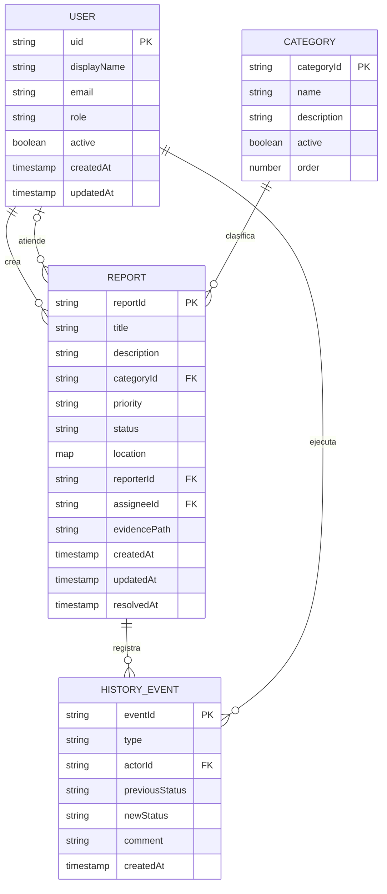

# Modelo de datos cloud de CampusFix

## 1. Objetivo

El modelo soporta el registro, consulta y seguimiento de incidentes de infraestructura en CampusFix. Se implementara en Cloud Firestore y usara Firebase Authentication para identificar a cada usuario y Firebase Storage para conservar la evidencia fotografica.

El diseno prioriza:

- integridad: los campos obligatorios y los valores permitidos se validan en la aplicacion y en las reglas de seguridad;
- seguridad: cada usuario consulta sus reportes y el personal autorizado gestiona el flujo operativo;
- trazabilidad: cada cambio relevante queda registrado en una subcoleccion de historial;
- escalabilidad: las consultas frecuentes se apoyan en indices y no requieren descargar toda la base de datos;
- coherencia: los tipos de TypeScript, el diccionario, las reglas y los documentos de Firestore usan los mismos nombres y valores.

## 2. Entidades

| Entidad | Proposito | Identificador |
| --- | --- | --- |
| `users` | Perfil y rol de los usuarios autenticados. | UID generado por Firebase Authentication. |
| `categories` | Catalogo administrable de tipos de incidente. | ID semantico, por ejemplo `infraestructura`. |
| `reports` | Informacion principal de cada incidente reportado. | ID automatico de Firestore. |
| `history` | Eventos de auditoria asociados a un reporte. | ID automatico dentro de `reports/{reportId}/history`. |

## 3. Diagrama entidad-relacion conceptual



> Firestore no aplica llaves foraneas como una base de datos relacional. Las referencias se representan mediante IDs y se protegen con reglas, validaciones y operaciones controladas por el servicio de datos.

## 4. Estructura fisica en Firestore

```text
users/{uid}
categories/{categoryId}
reports/{reportId}
reports/{reportId}/history/{eventId}
```

### Ejemplo de `users/{uid}`

```json
{
  "displayName": "Jeyson Sanchez",
  "email": "jeyson@universidad.edu",
  "role": "student",
  "active": true,
  "createdAt": "serverTimestamp()",
  "updatedAt": "serverTimestamp()"
}
```

### Ejemplo de `categories/{categoryId}`

```json
{
  "name": "Infraestructura",
  "description": "Danos o fallas en espacios, mobiliario y redes fisicas.",
  "active": true,
  "order": 1
}
```

### Ejemplo de `reports/{reportId}`

```json
{
  "title": "Luminaria apagada en bloque B",
  "description": "La luminaria del segundo piso no enciende desde ayer.",
  "categoryId": "infraestructura",
  "priority": "Media",
  "status": "Abierto",
  "location": {
    "label": "Bloque B - piso 2",
    "latitude": 4.710989,
    "longitude": -74.072092
  },
  "reporterId": "uid-estudiante",
  "assigneeId": null,
  "evidencePath": "evidence/uid-estudiante/report-id/foto.jpg",
  "createdAt": "serverTimestamp()",
  "updatedAt": "serverTimestamp()",
  "resolvedAt": null
}
```

### Ejemplo de `reports/{reportId}/history/{eventId}`

```json
{
  "type": "status_changed",
  "actorId": "uid-operador",
  "previousStatus": "Abierto",
  "newStatus": "En proceso",
  "comment": "Caso asignado al equipo de mantenimiento.",
  "createdAt": "serverTimestamp()"
}
```

## 5. Relaciones y cardinalidades

1. Un usuario puede crear cero o muchos reportes; cada reporte tiene un solo creador.
2. Un operador puede atender cero o muchos reportes; un reporte puede permanecer sin responsable.
3. Una categoria clasifica cero o muchos reportes; cada reporte tiene una categoria activa.
4. Un reporte contiene cero o muchos eventos de historial; cada evento pertenece a un solo reporte.
5. Un usuario autenticado origina cada evento de historial.

## 6. Reglas de negocio

1. Todo reporte nuevo inicia con estado `Abierto`.
2. Los estados validos son `Abierto`, `En proceso` y `Resuelto`.
3. Las prioridades validas son `Baja`, `Media` y `Alta`.
4. El creador del reporte debe coincidir con el UID autenticado.
5. `createdAt` y `updatedAt` se generan con la hora del servidor.
6. `resolvedAt` solo se registra cuando el estado cambia a `Resuelto`.
7. Un estudiante puede leer sus reportes, pero no asignarlos ni cambiar su estado.
8. Un operador o administrador puede asignar responsables y actualizar estados.
9. Solo un administrador puede mantener el catalogo de categorias o eliminar datos.
10. El historial es inmutable: se permite crear eventos, pero no editarlos ni eliminarlos desde la aplicacion.

## 7. Consultas principales

- reportes de un estudiante ordenados por fecha descendente;
- reportes por estado y fecha descendente;
- reportes por estado, prioridad y fecha descendente;
- reportes asignados a un operador;
- historial de un reporte ordenado cronologicamente;
- categorias activas ordenadas para el formulario.

Estas consultas determinan los indices compuestos que se documentaran y desplegaran junto con las reglas de Firestore.
